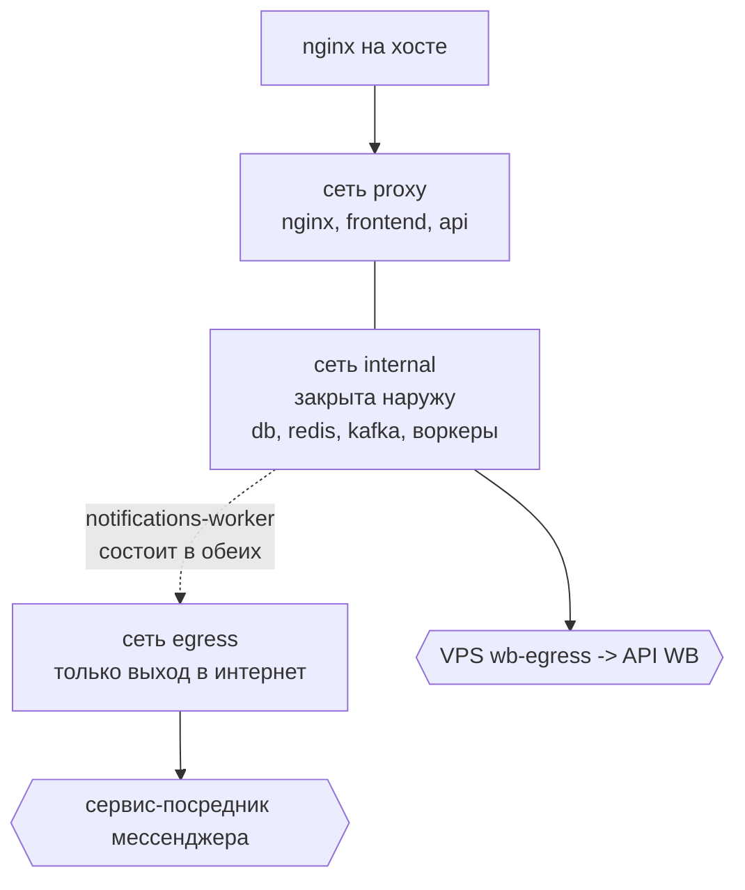
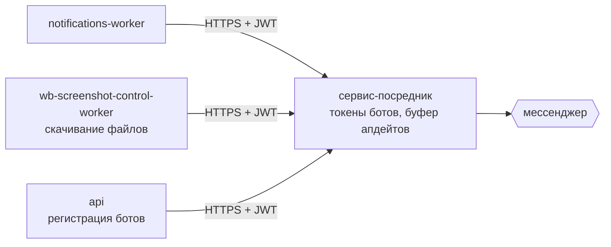
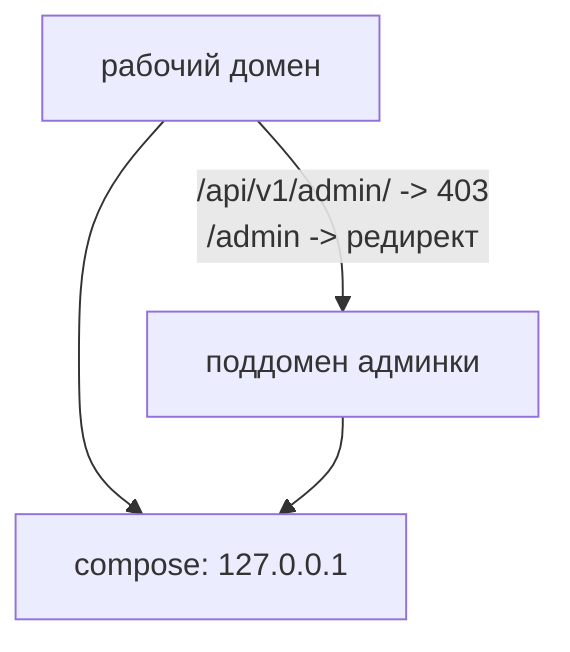

# Сети и исходящий трафик

Главное правило: **разные внешние системы требуют разного исходящего IP**, поэтому
«завернуть весь трафик» — не вариант ни в одну сторону.

| Куда | С какого адреса | Почему |
| --- | --- | --- |
| API Wildberries | закреплённый IP селлера на VPS wb-egress | лимиты и антифрод WB считаются по адресу |
| мессенджер (Telegram) | сервис-посредник | основной сервис к мессенджеру не обращается |

## Сети compose

Сеть `internal` помечена внутренней: контейнеры в ней не имеют маршрута наружу через
docker-мост и портов на хост не публикуют. Наружу ходят только те сервисы, которым это
нужно по делу.

## Сервис-посредник для мессенджера

Основной сервис не обращается к мессенджеру сам. Всё общение с ним идёт через отдельный
сервис-посредник (в коде и настройках — `relay`, свой репозиторий): он единственный хранит
токены ботов, принимает входящие апдейты и отправляет сообщения. Его адрес и параметры
подключения — вопрос эксплуатации и живут в `.env`, а не в этом репозитории.

К посреднику ходят трое. Воркер уведомлений — постоянно: забирает апдейты и отдаёт сообщения.
Воркер скриншотов — когда менеджер прислал боту файл (контракт v1.1, `RELAY_INTERACTIVE_ENABLED`).
`api` — только когда администратор регистрирует или удаляет бота: токен передаётся туда, где он
будет жить, а обратно приходят заголовок бота и шаблон ссылки-приглашения.

Почему отдельный сервис:

- **Токены ботов не лежат в основной базе.** Посредник хранит их у себя и наружу не отдаёт.
- **Мессенджер становится сменяемым.** Всё, что знает про Telegram — формат апдейтов, вид
  `t.me`-ссылки, кнопки, — заперто в посреднике. На основном сервере нет ни одного обращения к
  мессенджеру: бот адресуется кодом, чат — непрозрачной строкой, файл — непрозрачной ссылкой.

### Направление соединения

Инициатор соединения — всегда основной сервис. Апдейты не приносят, а забирают: посредник
копит их у себя, а воркер уведомлений спрашивает `GET /api/v1/updates?after=<курсор>` и держит
запрос, пока в канале тихо. Курсор в Postgres — единственный источник правды, подтверждений в
протоколе нет: потерянный ответ стоит повторной выдачи, а не потерянного апдейта.

### Канал

- **TLS с сертификатом посредника, запиненным на нашей стороне** (`RELAY_VERIFY` указывает на файл).
- **JWT (HS256) с общим секретом**, TTL 5 минут. Аудитории для двух направлений разные,
  иначе токен, выпущенный для похода к посреднику, работал бы и в обратную сторону.
- **Идемпотентный ключ на отправку** — идентификатор строки в очереди исходящих. Повтор
  после потерянного ответа посредник узнаёт сам, и сообщение не приходит в чат дважды.
- **Версия контракта** — `GET /api/v1/capabilities`; новые поля основной сервис шлёт только
  посреднику, который их знает.

## Исходящие IP для WB

Реализовано **закрепление**, а не ротация: отдельная VPS `wb-egress` с шестью
дополнительными адресами, по одному на селлера; там же живут ключи селлеров и
троттлинг. Прямых обращений к `*.wildberries.ru` с прод-сервера больше нет — все
WB-запросы обоих сервисов уходят на шлюз. Подробности — [WB_EGRESS.md](WB_EGRESS.md).

## Публичный контур

nginx на хосте терминирует TLS и проксирует на локальный порт compose; внутренний nginx
раздаёт собранный SPA и отправляет `/api` в приложение. Сертификаты живут на сервере и в
репозиторий не попадают.

**Доменов два: рабочий и админский.**

Бэкенд и сборка SPA у них общие, разный только вход: на рабочем домене админский префикс
API закрыт наглухо, а `/admin` уводит редиректом на поддомен. Это сетевой рубеж поверх
проверки прав в базе, а не вместо неё — [AUTH.md](AUTH.md). Фронтенд узнаёт, где он, по
имени хоста, поэтому локально оба интерфейса живут на одном адресе и админка ведёт себя
как обычный маршрут.

**Домены не хранятся в репозитории.** В нём лежат шаблоны хостовых конфигов, а готовые
файлы существуют только на сервере: скрипт рендеринга подставляет в них значения из
`.env` и перезагружает nginx. Хостовой nginx деплоем не обновляется — этот скрипт и есть
способ его обновить.

Третий шаблон, `bootstrap`, рендерится, но не включается: он нужен на время выпуска
сертификата, когда TLS-конфиг ещё не может подняться, и включается руками.

Внутренний nginx отдаёт хешированные бандлы с вечным кешем, а `index.html` — с запретом
кеша: он единственный знает имена бандлов, и закешированная копия переживала бы деплой,
ссылаясь на файлы, которых уже нет. Отсутствующий бандл честно отвечает `404`, а не
проваливается в `index.html` — иначе браузер получал бы HTML вместо скрипта и показывал
белый экран.
