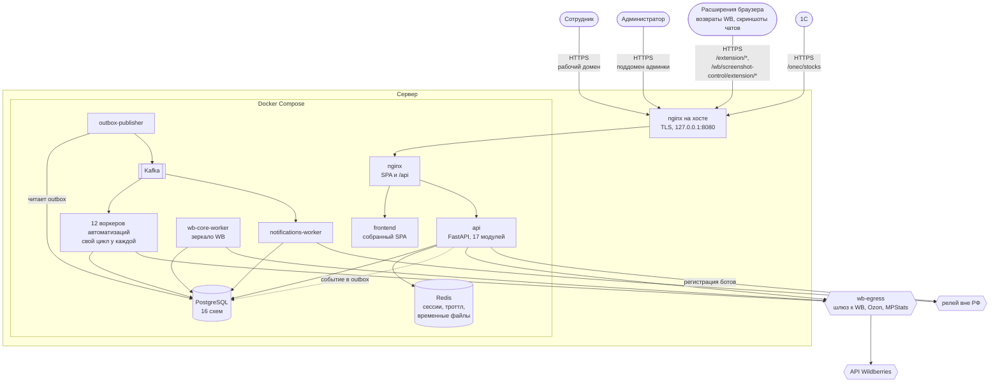

# Контур целиком

## Процессы

В compose двадцать три сервиса. Шестнадцать из них — наши долгоживущие процессы (`api` и
пятнадцать воркеров), остальное — хранилища, фронт, бэкапы и одноразовые задачи.

| Процесс | Зачем | Реплик |
| --- | --- | --- |
| `api` | HTTP для SPA, расширения и 1С: селлеры, все автоматизации, вход, админка | сколько угодно |
| `wb-core-worker` | зеркало WB по всем активным селлерам: каталог, остатки, отзывы, задания и поставки FBS, чаты, остатки по складам WB, отчёты реализации, реклама, начисления Ozon | 1 (расписание) |
| `wb-reviews-worker` | ставит ночной прогон отзывов, чинит зависшие job'ы, слушает Kafka | 1 (расписание) |
| `wb-turnover-worker` | снимки остатков, догрузка заказов, расчёт, дайджест | 1 (расписание) |
| `wb-card-checklist-worker` | карточки, цены и справочник для чек-листа | 1 |
| `wb-card-documents-worker` | документы карточек: изменённые карточки раз в час, дайджест | 1 |
| `wb-fbs-stocks-worker` | склады и остатки FBS для таблицы по группам | 1 |
| `wb-fbs-penalties-worker` | суточные финансовые отчёты: штрафы и удержания | 1 |
| `wb-fbs-distribution-worker` | сверка складов кабинета для распределения остатков FBS | 1 |
| `wb-returns-worker` | отчёт о возвратах и заявки, дайджест в четыре слота, команды бота | 1 |
| `wb-support-bot-worker` | разбор диалогов из зеркала чатов и напоминания покупателям | 1 |
| `wb-podsort-worker` | суточные итоги заказов для подсорта | 1 |
| `fin-reports-worker` | складывает отчёты реализации и начисления Ozon в суммы по артикулам | 1 |
| `wb-screenshot-control-worker` | контроль скриншотов ДБС: консьюмеры распознавания и решения, выгрузка в S3, истечение исхода, сверка и чистка хранилища; в WB не ходит, наружу — к модели Cloud.ru и в S3 | **строго 1** (решения по одному в порядке приёма) |
| `notifications-worker` | забор апдейтов у релея, очередь исходящих, отправка через релей | **строго 1** |
| `outbox-publisher` | переносит события из таблицы outbox в Kafka | 1 |
| `migrate` | прогоняет цепочки миграций всех 16 схем и завершается | одноразовый |
| `pg-backup` | суточные дампы базы | 1 |

Расписание каждого воркера — в [WORKERS.md](WORKERS.md). Воркеров ровно столько же,
сколько модулей со своим сбором: у `wb_review_chats` и `wb_box_stickers` воркера нет — первый
читает зеркало чатов, второй работает только по запросу пользователя. Воркер
`wb_screenshot_control` ничего не собирает: он разбирает присланные скрины (консьюмеры Kafka) и
держит фоновые шаги модуля.

`notifications-worker` в единственном экземпляре не по соображениям нагрузки: у каждого
бота один курсор обработки, и вторая реплика забирала бы у релея те же апдейты, что и
первая. Само ограничение «один токен — один поллер» живёт теперь на релее, где токены и
лежат; здесь остаётся его следствие.

Остальные воркеры тоже в одном экземпляре, но по другой причине: расписание внутри
процесса, а не внешний планировщик. Вторая реплика запустила бы те же слоты второй раз;
от дублей спасают уникальные ключи слота в базе, но бессмысленная работа осталась бы.

## Где какие решения приняты

- Почему всё в одном процессе-монолите и как модули не срастаются — [MODULES.md](MODULES.md).
- Почему база одна, а схем по одной на модуль — [DATA.md](DATA.md).
- Почему автоматизация не отправляет сообщение сама, а кладёт событие — [EVENTS.md](EVENTS.md).
- Почему воркеры не ходят в Telegram напрямую с прод-сервера — [NETWORK_AND_EGRESS.md](NETWORK_AND_EGRESS.md).

## Что снаружи

**Wildberries** — группы API с раздельными бюджетами лимитов: контент (каталог), отзывы,
статистика (остатки FBO, заказы), маркетплейс (остатки и задания FBS), аналитика и
финансы, чаты покупателей, возвраты, поставки FBO. Почти всё — чтение. Записи две, и обе
включаются отдельно: бот поддержки пишет покупателям в чаты (сухой прогон по умолчанию), а
распределение остатков FBS создаёт виртуальные склады и публикует остатки только у
кабинета с включённой записью. Подробности про лимиты — [WB_API.md](WB_API.md).

**Ozon и MPStats.** Начисления Ozon по дням попадают в зеркало `wb_core`. MPStats воркеры
не трогают: к нему ходят менеджеры через MCP, токены заводятся в админке. Оба — тем же
путём, через шлюз, ключей у нас нет ([OZON_API.md](OZON_API.md),
[MPSTATS_API.md](MPSTATS_API.md)).

**Шлюз wb-egress** — единственный, кто знает ключи селлеров и выходит к маркетплейсам со
своих закреплённых адресов. Приложение называет селлера по имени, шлюз подставляет ключ
([WB_EGRESS.md](WB_EGRESS.md)).

**Мессенджер** — исходящие сообщения и входящие от подписчиков. Напрямую туда не ходит
никто: с российского адреса `api.telegram.org` недоступен, поэтому весь обмен идёт через
релей вне РФ — [NETWORK_AND_EGRESS.md](NETWORK_AND_EGRESS.md). Токенов ботов на этом
сервере нет.

**Входящие клиенты кроме браузера.** Расширение для возвратов WB присылает код получения
и адреса ПВЗ, привязываясь к кабинету одноразовым кодом; 1С присылает остатки для
распределения FBS. Оба ходят в `api` со своим способом авторизации, а не по сессии
сотрудника.

Больше внешних зависимостей нет: S3 подключается опционально и сейчас выключен.

К релею ходят двое: воркер уведомлений — за апдейтами и с сообщениями, `api` — когда
администратор регистрирует бота и токен нужно передать туда, где он будет жить.

## Два входа

Интерфейс один и тот же, доменов два: рабочий и поддомен админки. На рабочем домене
nginx закрывает `/api/v1/admin/`, поэтому раздел с сотрудниками и ботами открывается
только со второго адреса — [NETWORK_AND_EGRESS.md](NETWORK_AND_EGRESS.md),
[AUTH.md](AUTH.md).

## Границы, которые держим

- **Автоматизация не знает про чаты.** Она кладёт событие и называет бота по коду;
  кому это уедет, решает модуль уведомлений.
- **Модуль не ходит в чужую схему.** Реестр селлеров спрашивает автоматизации через порт,
  а не удаляет их данные сам.
- **Автоматизации друг у друга не читают.** Нужное двоим лежит в зеркале `wb_core`, и это
  проверяет тест границ модулей — [MODULES.md](MODULES.md).
- **Секреты не покидают базу в открытом виде.** Ключи WB расшифровываются в момент
  запроса и никогда не попадают ни в события Kafka, ни в логи, ни в API. Токенов ботов
  здесь нет вовсе: они живут на релее.
